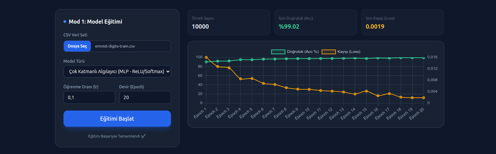
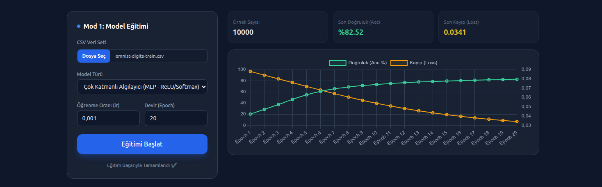
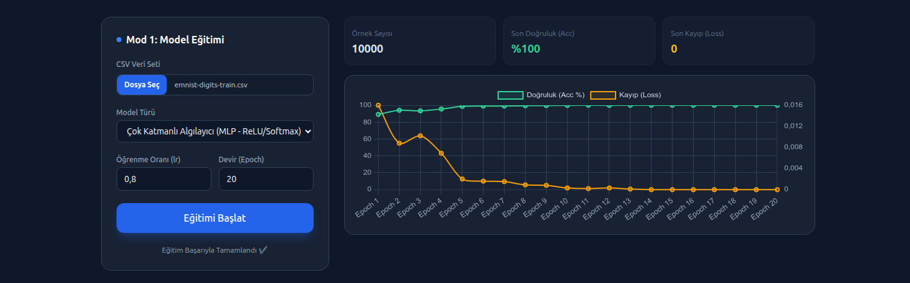
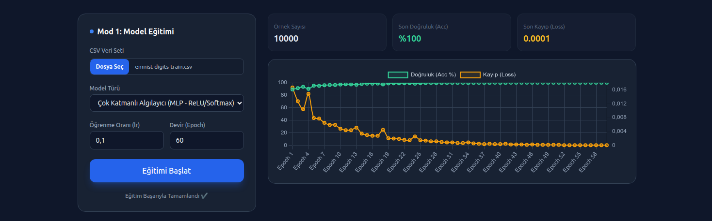
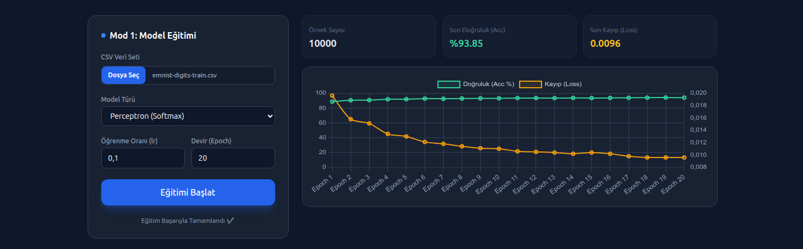
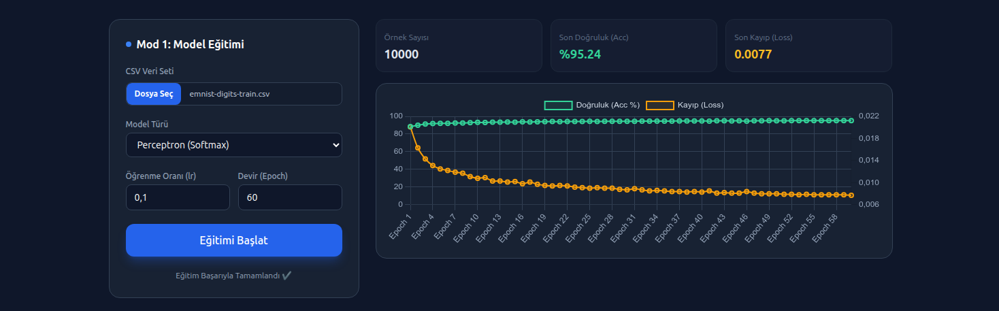

# 🧠 Yapay Sinir Ağı Laboratuvarı (From-Scratch MLP & Perceptron)

Bu proje, TensorFlow veya PyTorch gibi hazır derin öğrenme kütüphaneleri kullanılmadan, yalnızca **NumPy** ve saf matematiksel geri yayılım (backpropagation) algoritmalarıyla sıfırdan geliştirilmiş interaktif bir Yapay Sinir Ağı eğitim ve karar sınırı analiz platformudur.

---

## 🖥️ Uygulama Arayüzü ve Özellikler


* **Sıfırdan Matematiksel Çekirdek:** İleri yayılım (Forward Propagation), geri yayılım (Backpropagation), ReLU, Softmax ve Cross-Entropy Loss fonksiyonlarının saf NumPy implementasyonu.
* **Mod 1 — İnteraktif Model Eğitimi:** EMNIST Digits / MNIST veri setleri üzerinde model mimarisi (MLP veya Tek Katmanlı Perceptron), öğrenme oranı (`lr`) ve devir (`Epoch`) sayısı seçilerek canlı yakınsama grafiği takibi.
* **Mod 2 — Canlı Piksel Deformasyon & Olasılık Analizörü:** 28x28 piksel ızgarası üzerinde gerçek zamanlı rakam şablonu düzenleme, piksel ekleme/silme ve 0–9 sınıflarına ait Softmax olasılık dağılımlarının anlık gözlemi.

---

## 🧪 1. Bölüm: Çok Katmanlı Algılayıcı (MLP) Hiperparametre Analizi

**EMNIST Digits (10.000 örnek)** veri seti üzerinde gizli katmanlı ve **ReLU / Softmax** aktivasyonlu MLP mimarisinin farklı Öğrenme Oranı (`lr`) ve Devir (`Epoch`) kombinasyonlarındaki öğrenme dinamikleri test edilmiştir.

### 1.1. İdeal Yakınsama (Referans Model): `lr = 0.1`, `Epoch = 20`



* **Eğri ve Davranış Analizi:** 
  * Kayıp (turuncu) eğrisi ilk 5 epoch içinde dik bir ivmeyle düşerek ağın el yazısındaki temel kenar ve kıvrım özelliklerini hızla öğrendiğini gösterir.
  * 10. epoch sonrasında eğrideki dalgalanmalar minimuma iner ve model yerel minimumlara takılmadan kararlı bir şekilde yüksek doğruluğa oturur.

---

### 1.2. Düşük Öğrenme Oranı (Yavaş Yakınsama / Underfitting): `lr = 0.001`, `Epoch = 20`



* **Eğri ve Davranış Analizi:** 
  * Referans modele (`lr = 0.1`) kıyasla ağırlık güncellemeleri çok küçük adımlarla yapıldığı için kayıp eğrisi oldukça yatay ve yavaş bir eğimle iner.
  * 20 epoch sonunda model henüz optimum ağırlıklara ulaşamamıştır (**Underfitting**); aynı doğruluğa erişmek için devir sayısının çok daha yüksek tutulması gerekir.

---

### 1.3. Yüksek Öğrenme Oranı (Gradyan Salınımı / Overshooting): `lr = 0.8`, `Epoch = 20`



* **Eğri ve Davranış Analizi:** 
  * İdeal modeldeki pürüzsüz inişin aksine, bu senaryoda kayıp ve doğruluk eğrilerinde sert zikzaklar (salınımlar) görülür.
  * Büyük öğrenme adımları nedeniyle gradyan inişi hata yüzeyindeki minimum noktanın üzerinden atlar (**Overshooting**), bu da ağırlıkların kararsızlaşmasına yol açar.

---

### 1.4. Yüksek Devir Sayısı (Aşırı Uyum / Overfitting Riski): `lr = 0.1`, `Epoch = 60`



* **Eğri ve Davranış Analizi:** 
  * 20. epoch'tan sonra doğruluk eğrisi neredeyse düz bir plato haline gelir ve kayıp değeri sıfıra çok yaklaşır.
  * Eğitim setindeki başarının marjinal olarak artmasına karşın, model eğitim verisindeki gürültüyü ezberlemeye (**Overfitting**) başlar; bu durum Mod 2'deki yeni/deforme çizimlerde genelleme yeteneğini zayıflatabilir.

---

## ⚖️ 2. Bölüm: Tek Katmanlı Perceptron Kapasite Sınırı Testi

Gizli katmanı bulunmayan doğrusal (lineer) bir model olan **Tek Katmanlı Perceptron**'un aynı veri seti (**EMNIST Digits - 10.000 örnek**) üzerindeki öğrenme tavanını gözlemlemek amacıyla iki farklı eğitim süresi test edilmiştir.

### 2.1. Standart Perceptron Eğitimi: `lr = 0.1`, `Epoch = 20`



* **Eğri ve Davranış Analizi:** 
  * Eğitim ilk birkaç epoch'ta hızlı bir yükseliş gösterse de, doğruluk eğrisi MLP'deki gibi yüksek bantlara tırmanamaz ve erken bir doygunluk noktasına ulaşır.
  * Kayıp eğrisi belirli bir eşik değerin altına inemez ve yatay bir seyir izler.

---

### 2.2. Perceptron Kapasite Sınırı Testi: `lr = 0.1`, `Epoch = 60`



* **Eğri ve Davranış Analizi:** 
  * Eğitim süresi 20 epoch'tan 60 epoch'a çıkarılmasına rağmen doğruluk ve kayıp değerlerinde anlamlı bir iyileşme görülmez.
  * **Temel Neden (Linear Separability):** Tek katmanlı Perceptron girdi piksellerine yalnızca doğrusal bir hiperdüzlem çizebilir. El yazısı rakamların (özellikle `3`, `5`, `8` ve `9` gibi kıvrımlı sınıfların) karar sınırları doğrusal olmadığı için model kapasite sınırına (**Model Bias**) takılır. MLP ise gizli katmanı ve **ReLU** aktivasyonu sayesinde bu doğrusal olmayan sınırları çözebilmiştir.

---

## 🔬 3. Bölüm: Canlı Piksel Deformasyonu & Karar Sınırı Gözlemi (Mod 2)

* **Domain Shift ve Kalınlık Etkisi:** EMNIST veri setindeki el yazısı karakterleri ince ve eğik hatlara sahipken, Mod 2 şablon çizimleri kalın piksel bloklarından oluşur. 
* Örneğin kalın hatlı `9` şablonunda üst halka ile alt kıvrım arasındaki ağırlık çakışması nedeniyle model ilk aşamada `3` (%41.9) veya `5` (%32.0) sınıflarına yüksek olasılık atayabilmektedir. 28x28 ızgara üzerinden kenar pikselleri silinerek çizim inceltildiğinde Softmax olasılığı yüksek güvenle `9` sınıfına kaymaktadır.

---

## 🛠️ Kurulum ve Çalıştırma

1. Depoyu bilgisayarınıza klonlayın:
   ```bash
   git clone [https://github.com/aysenurgundogmus/](https://github.com/aysenurgundogmus/)<numpy-mlp-perceptron-lab>.git
   cd <repo-adi>